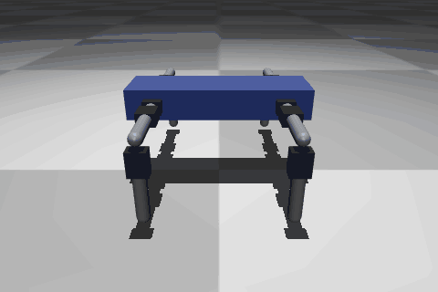
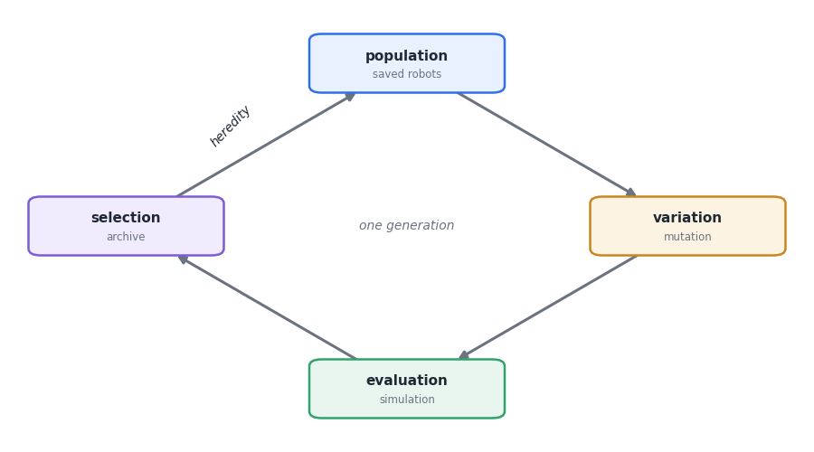
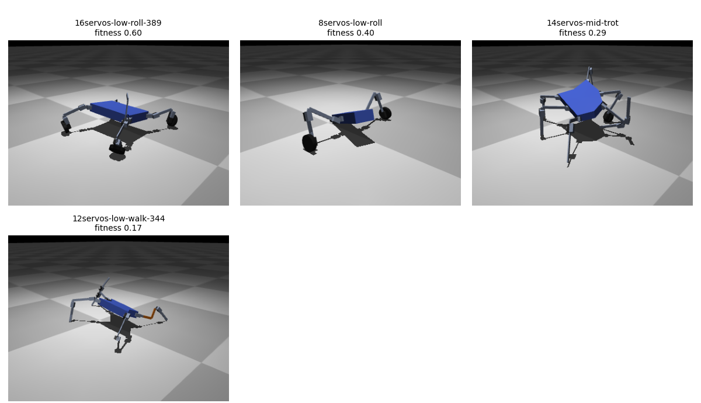
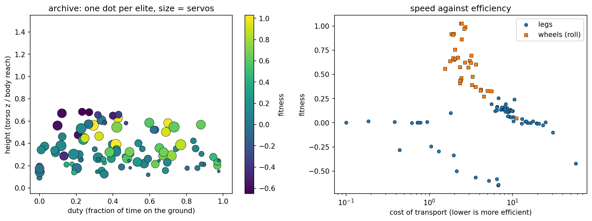
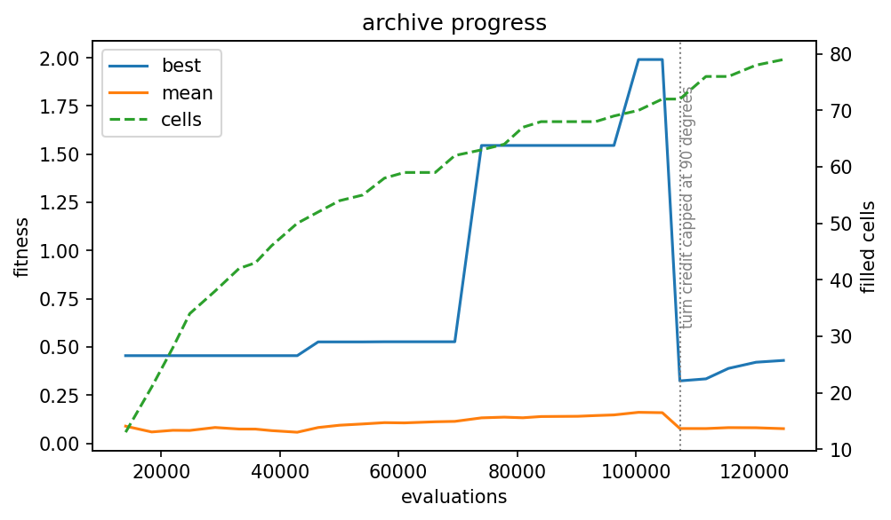
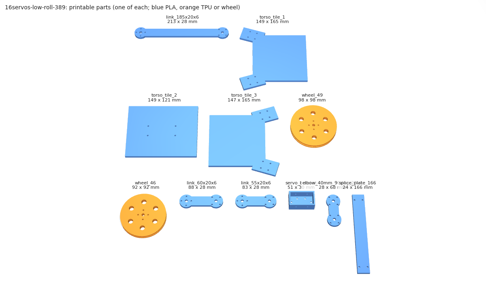

# darwinbot

[](https://github.com/mpena2099/darwinbot/actions/workflows/tests.yml)
[](LICENSE)

Quality-diversity evolution of robot bodies and locomotion controllers, built
from real parts so the result can be printed and assembled.



Every robot is a tree of real modules (Karl Sims and Revolve2 style): a core
(torso plate, ESP32, LiPo) with servo joints, passive links, TPU springs, tails,
skids, spikes, caster wheels, wheels and feet hanging from its slots, driven by
Feetech STS3215 servos. Only the interfaces are fixed (servo, horn and bracket
holes, M3 screws, electronics); link length, section, elbow, roll, mount
position and foot size are continuous genes, and a body that the printer or the
servo torque could not deal with is not buildable. Bodies are evolved
with a MAP-Elites archive laid out by behaviour and cost, while a central
pattern generator with two harmonics per joint and load feedback (Tegotae) is
tuned with CMA-ES for each candidate body. Any robot in the archive can be
exported as printable parts, a bill of materials and a control file for an ESP32.

## Resumo em português

Quem está começando com algoritmos evolutivos pode ler antes o
[guia em português](docs/guia-evolucao.md).

O DarwinBot inventa robôs e ensina cada um a andar, numa simulação física
(MuJoCo). A evolução decide o corpo, uma árvore de módulos: quantas pernas, de que
tamanho (medidas contínuas, em milímetros), em que direção cada junta gira, onde
cada peça se prende no tronco, e se a perna termina numa roda. Há também módulos
passivos sem servo: mola de TPU, cauda com contrapeso, patim, espeto e roda
livre. Só entram corpos que a impressora e o servo aguentam: peças de até
220 mm, links que não dobram sob o torque do servo e tronco cortado em placas
emendadas. Para cada
corpo, um otimizador (CMA-ES) procura o ritmo de movimento das juntas, com dois
harmônicos e um retorno da carga dos servos, que leva o robô mais longe. Em vez de
um único vencedor, o programa guarda o melhor robô de cada comportamento (MAP-Elites
por tempo de contato com o chão, altura do tronco e número de servos), formando um
catálogo de soluções diferentes. Os robôs são montados com peças reais (servos
STS3215, peças impressas em 3D, ESP32 e bateria LiPo), treinados com física
propositalmente variada para resistir às diferenças entre simulação e mundo real,
e qualquer um deles pode ser exportado como peças STL, lista de materiais, guia de
montagem e arquivo de controle. Código e documentação técnica em inglês; os dados
de hardware em `docs/` estão em português.

## In one paragraph

The program invents robots and teaches each one to move. A robot is a tree of
modules; evolution decides how many limbs, how long (continuous lengths, in
millimetres), which way each joint turns, where each part mounts on the torso
and whether a limb ends in a wheel. Passive modules without a servo (TPU spring,
tail with counterweight, skid, spike, caster wheel) are part of the search. A
body the printer or the servo could not handle is not buildable and is never
simulated. For every new body, an optimiser searches for
the rhythm of joint movements that carries it farthest forward in a few simulated
seconds. The run does not keep a single winner: it keeps the best robot for each
*behaviour* (crawling low with few servos, trotting tall with many, rolling...),
so at the end you can browse a catalogue of different solutions.

## New to evolutionary algorithms?

Read the beginner guide: [English](docs/evolution-guide.md) ·
[Português](docs/guia-evolucao.md). It explains genomes, mutation, fitness,
CMA-ES, MAP-Elites, novelty search and the reality gap, each with pointers to
the code and small experiments to run on a laptop.



## How it works

Two nested loops:

1. **Outer loop, MAP-Elites over behaviour.** The archive is a pyribs
   CVTArchive with about 500 cells over four descriptors measured in the nominal
   flat-floor episode: `duty` (fraction of time the ground-touching tips are on
   the floor), `height` (mean torso height over the body reach), `legs`
   (limbs on the torso with a joint and no wheel, so a hexapod never competes
   with a two-legged crawler for a cell) and `cot`, the cost of transport (mechanical work per
   weight and distance, on a log scale). The last one lets an efficient walker
   keep its own cell next to a faster but hungrier roller. Each cell keeps the best body found there, so a run ends
   with a map of specialists instead of a single design. Parents are drawn with
   probability proportional to their novelty (mean distance to the 10 nearest
   elites in descriptor space), which pushes the search towards sparse regions.
2. **Inner loop, CMA-ES over the controller.** For a fixed body, CMA-ES searches
   the controller genes that this body actually uses. A promising body is
   therefore judged by the best gait it can learn, not by a lucky random
   controller.

Children are mutated copies of elites, or grafts of two elites. The child starts its inner loop from the
parent controller, so learned gaits are inherited along with the body
(Lamarckian inheritance). Controller genes are indexed by the stable slot id of
each module, so a mutation that keeps a module keeps its control. Only the genes
that affect the child are optimised; the rest stay in the genome and become
active again if a module returns.

Construction rules act as natural selection by the printer. A body is buildable
only if every part fits a 220 mm print bed, every link bends under the 1.91 N*m
servo stall torque with a stress of at most 25 MPa (half of what PLA takes), and
no parts overlap at spawn. The torso is not limited: it is split into bed-sized
tiles joined by splice plates. A body that breaks a rule scores as unbuildable
and is never simulated.

## Install

```bash
python -m venv venv && source venv/bin/activate
pip install -e .
```

Dependencies: `mujoco >= 3.6`, `numpy >= 1.23`, `cma >= 3.3`, `ribs >= 0.12`,
`matplotlib >= 3.6`. Optional extras:

```bash
pip install -e ".[video]"      # video recording (imageio + ffmpeg)
pip install -e ".[cad]"        # STL parts in the export (build123d)
pip install -e ".[gpu]"        # MJX backend (jax with CUDA 12)
```

## Run

```bash
# Evolve on the flat floor with the default settings
python experiments/train.py

# Flat, rough, steps and rubble, with more batches and workers
python experiments/train.py --terrains terrain --batches 60 --workers 8

# Learn to turn in place instead of walking forward
python experiments/train.py --task turn

# Only some environments (see "Choosing the environments")
python experiments/train.py --terrains rubble,soft

# Climb a 3 cm step, or carry 0.3 kg on the torso
python experiments/train.py --terrains step
python experiments/train.py --payload 0.3

# Resume a previous run (task and payload come from the archive)
python experiments/train.py --resume checkpoints/archive.pkl --batches 20

# Draw parents by novelty (default) or uniformly at random
python experiments/train.py --parent-selection uniform

# Replay the best elite in the MuJoCo viewer (flat terrain)
python experiments/replay.py

# List the robot types found so far, then open one of them
python experiments/replay.py --list
python experiments/replay.py --type 8servos-mid-trot --terrain rough

# Record a video instead of opening a window (needs the video extra)
python experiments/replay.py --record out.mp4 --seconds 8

# Train on randomised models (default 2 per terrain on cpu, 0 on gpu)
python experiments/train.py --variants 4

# Check the elite on 50 randomised models per terrain (PASS if mean loss < 30%)
python experiments/validate.py --n 50

# Export a robot to build: parts, bill of materials, assembly, control file
python experiments/export.py --type 8servos-mid-trot

# Plot the behaviour scatter and the progress curves
python experiments/plot_archive.py
python experiments/plot_archive.py --show

# Family tree: ancestors of one robot, or ancestor variety against fitness
python experiments/lineage.py --type 8servos-mid-trot
python experiments/lineage.py
```

### Gallery

```bash
# Static site with an interactive map of the archive and a 3D replay of each robot
python tools/make_site.py            # all buildable elites; --max 12 for a small one
python -m http.server -d docs/site   # preview at http://localhost:8000
```

GitHub Pages can serve `docs/site` once the repository is public.

Training writes `checkpoints/archive.pkl` after every batch. `replay.py` reads
that file by default (`--archive` changes it). `plot_archive.py` saves
`archive_heatmap.png` (the behaviour scatter plot: one dot per elite at its duty
and height, coloured by fitness, sized by servo count) and `archive_history.png`
to `checkpoints/` (`--out` changes the directory).

`--variants N` scores every candidate gait on N randomised copies of each
terrain (friction, mass, servo torque and stiffness, joint play, 0 to 2
control periods of command delay) and takes the mean, so gaits that depend on
exact simulator details lose. It costs about N times more per evaluation, is
CPU only, and is stored in the archive. `validate.py` runs the elite on
`--n` fresh variants (`--seed`, `--workers`) and prints nominal, mean and
worst distance, fall rate and relative loss per terrain.

### GPU (optional)

The inner CMA-ES loop can run on an NVIDIA GPU through MJX. The CPU remains the
default and works without JAX installed.

```bash
pip install -e ".[gpu]"
python experiments/train.py --device gpu --popsize 128
```

On the GPU, bodies are optimised one at a time and `--workers` is ignored (one
device, and forking with CUDA does not work). `--popsize` defaults to 64 on the
GPU. A strong NVIDIA GPU is needed to beat the CPU: the GeForce 940MX on this
machine is about 12x slower.

### Viewing the different robot types

The archive keeps one robot per **cell** of the behaviour map: the best one found
with that duty, height, number of legs and cost of transport (four descriptors). A new robot only replaces the one in
its own cell, and only if it scores higher, so slow crawlers survive next to
fast rollers.

A type is a short name derived from the cell, `<servos>servos-<height>-<gait>`
(for example `8servos-mid-trot`):

| Part | Values | Meaning |
|------|--------|---------|
| `servos` | 1 to 16 | number of servos, the cost of the robot (shown in the name, not a map axis) |
| `height` | `low`, `mid`, `high` | mean torso height over body reach: below 0.4, below 0.8, above |
| `gait` | `crawl`, `walk`, `trot`, `belly`, `roll` | duty, the share of time the tips touch the ground: above 0.8, 0.5 to 0.8, 0.15 to 0.5, below 0.15 (sliding on the body); `roll` when wheels carry more than half of the contact time |

Several cells can share a name; the later ones get the cell index appended
(`12servos-low-walk-133`).

Step 1, see which types the run has found, best first:

```
$ python experiments/replay.py --list
type                       fitness  duty  height  servos    cot
8servos-mid-trot              0.11  0.34    0.45       8    6.2
12servos-low-trot            -0.03  0.41    0.28      12   21.4
12servos-low-walk-133        -0.03  0.52    0.33      12   18.7
...
```

Step 2, open one in the 3D viewer (or add `--record name.mp4` for a video):

```bash
python experiments/replay.py --type 8servos-mid-trot
```

Without `--type`, `replay.py` shows the best robot overall.

### Viewer controls

`replay.py` without `--record` opens the interactive MuJoCo viewer: left drag
rotates the camera, right drag pans, scroll zooms, double click selects a
body and Ctrl + double click makes the camera follow it, space pauses, Tab
hides the side panels. `--speed 0.25` plays in slow motion (the window has
no speed control of its own). The simulation does not reset, so the robot eventually
leaves the terrain.

### Long runs

A run on the `terrain` preset with 3 workers and the default 2 variants takes
roughly 30 to 40 min for the initial batch and 6 to 8 min for each later batch
(5 s episodes, 0.004 s physics step, 120 CMA-ES evaluations per child; see
`--seconds`, `--variants`, `--budget-init` and `--budget-child`). The archive is saved after
every batch; stopping mid-batch loses only that batch. Keep the machine awake
and the process alive when the terminal closes:

```bash
tmux new -s darwin
systemd-inhibit --what=sleep python experiments/train.py --terrains terrain --batches 40 --workers 3
# detach with Ctrl+b d, reattach with: tmux attach -t darwin
```

## Training on Kaggle

A long run keeps a laptop busy for a day. Two notebooks in `tools/kaggle/` run
on Kaggle's free sessions instead:

- `train_cpu.ipynb`: trains on a 4-core CPU session of up to 12 hours with the
  browser closed. The archive lands in the notebook output; adding that output
  as an input to the next session resumes the run.
- `benchmark_gpu.ipynb`: measures episodes per second on the CPU and on a free
  GPU (MJX) for the same body and batch sizes from 16 to 1024. A GPU only helps
  when it simulates hundreds of copies at once and every new body costs it a
  compile, so this tells whether it pays off here. The same comparison runs
  locally with `python tools/kaggle/bench_gpu.py`. On a free Kaggle GPU (2x T4)
  MJX ran 0.6 to 1.5 episodes per second at any batch size from 16 to 1024,
  against 13 to 15 on the session's 4 CPU cores, spent 17 to 47 s compiling
  every body, and cannot collide a wheel (cylinder) with a box, which rules out
  wheeled robots on steps and rubble. Training stays on the CPU.

Upload a notebook with *Create > New Notebook > File > Import Notebook*. While
the repository is private, add a Kaggle secret `GITHUB_TOKEN` with read access.

## Exporting a robot to build

`experiments/export.py --type <type>` writes `exports/<type>/`:

| File | Content |
|------|---------|
| `control.json` | the evolved controller for the ESP32 firmware (format 2), described in `docs/formato-controle.md` |
| `bom.md`, `bom.csv` | servos, printed parts with quantities and material, electronics, screws, tyres |
| `assembly.md` | one row per servo in layout order: id, node slot, parent chain in words (for example `core right-front > joint pitch > joint roll`), axis, link length, sign; mounting direction and calibration step |
| `parts/*.stl` | one file per distinct size (needs the `cad` extra): `link_{L}x{W}x{T}.stl`, `elbow_{D}mm_{A}deg_{W}x{T}.stl`, `foot_{R}.stl`, `wheel_{R}.stl`, `spring_{W}x{B}.stl`, `tail_{L}.stl`, `skid.stl`, `spike.stl`, `caster_wheel_{R}.stl`, `caster_fork.stl`, `servo_bracket.stl`, the torso as `torso_plate.stl` or `torso_tile_{i}.stl`, and `splice_plate_{span}.stl` across each torso cut (sizes in whole millimetres) |
| `robot.xml` | the MuJoCo model, for inspection |

The export walks the module tree: every joint, link and spring needs a link of
its own length and section, every elbow an elbow plate for its distance and
angle, every servo one bracket, every wheel, caster, tail, skid, spike and foot
(explicit, or the free tip of a limb) one print. Links, elbows, feet and springs
get one STL per distinct size. Springs and spikes are printed in TPU, the rest in
PLA. The bill of materials counts everything from the tree.

Servo dimensions in `darwinbot/parts.py` (horn and mounting holes, body size)
are placeholders marked "measure a real STS3215 and update": check them
against a real servo before printing.

## Tests

```bash
pip install pytest
pytest tests/ -q
```

## Genome

All genes are normalised to `[0, 1]` and mapped linearly onto their physical
range on decode, so one mutation sigma works for every gene.

### Body genome (`darwinbot/morphology.py`)

A tree of modules: `core`, `joint`, `link`, `spring`, `wheel`, `foot`, `tail`,
`skid`, `spike` and `caster`. Joints and wheels carry an STS3215 servo; links,
springs, tails, skids, spikes, casters and feet are passive. The genome is a
fixed vector of `MORPH_LENGTH = MAX_NODES * 13 = 260` genes: one block of 13
genes per node slot, with `MAX_NODES = 20`. Block 0 is always the core; the block index
is the stable slot id of the node. A block is

| Gene | Meaning |
|------|---------|
| `active` | the module exists when > 0.5 |
| `parent` | slot id of the parent module |
| `slot` | attachment slot on the parent (core: 8 slots, front, back, left and right sides; joint, link and spring: tip and two sides) |
| `rot` | roll of the attachment around the slot direction, any angle in [0, 2*pi) |
| `type` | joint, link, spring, wheel, foot, tail, skid, spike or caster |
| `axis` | joint turns about pitch, yaw or roll |
| `length` | link length 40 - 200 mm (tail: bar length) |
| `wheel` | wheel or caster radius (wheel 30 - 60 mm, caster 15 - 35 mm), or foot radius 8 - 30 mm; for a tail, the counterweight 0 - 100 g |
| `flip` | joint axis reversed (how a mirrored copy keeps the same signal) |
| `width` | link section width 12 - 30 mm |
| `thick` | link section thickness 3 - 10 mm; for a spring, the TPU blade 2 - 8 mm |
| `offset` | on the core: mount position along the torso edge; on a link side slot: elbow distance 25 - 80 mm |
| `angle` | on the core: mount yaw up to +/-60 degrees; on a link side slot: elbow angle 30 - 150 degrees |

Passive module physics: a spring is a hinge whose stiffness follows from the TPU
blade thickness (see "Mola de TPU" in `docs/hardware-dados.md`); a tail is a bar
with a counterweight at the tip; a skid has low friction (0.15), a spike high
friction (1.6); a caster is a free wheel on a passive hinge. None has a servo.

For the core block, `length` and `wheel` hold the torso length (0.15 - 0.40 m)
and width (0.10 - 0.25 m). `decode()` accepts any vector and always returns a
body within `MAX_NODES`, `MAX_SERVOS = 16` and depth 5: blocks that are
inactive, unreachable, clash on a slot or break a limit are dropped. A joint or
link with no child ends in an implicit foot.

Mutation works on the decoded tree: nudge a continuous measure (one step in five
is a large jump), stretch or shrink a whole limb, change a module type (including
into a passive kind), add a module or small subtree, remove a subtree, duplicate
a subtree mirrored on the opposite slot, or copy it to another free slot. One
child in five is instead a graft: a whole limb of a second elite is attached to
a free slot of the parent, mirrored when the opposite torso side is free, the
crossover Sims (1994) used for his creatures. The initial population mixes
small random trees with seeds that reproduce mirrored leg pairs, with and
without wheels.

### Controller genome (`darwinbot/controller.py`)

Length: `CTRL_LENGTH = 1 + MAX_NODES * 6 = 121`, indexed by the same node slot ids.

| Index | Gene | Range | Meaning |
|-------|------|-------|---------|
| 0 | `frequency` | 0.5 - 3.0 Hz | global natural frequency, `omega = 2*pi*frequency` |

Per node slot `s`, with base `b = 1 + 6 * s`:

| Offset | Gene | Range | Meaning |
|--------|------|-------|---------|
| +0, +1 | `amp1`, `phase1` | 0 - 0.8 rad, 0 - 2*pi | first harmonic |
| +2 | `offset` | -0.6 - 0.6 rad | joint centre (for a wheel: signed speed, -5.45 - 5.45 rad/s) |
| +3, +4 | `amp2`, `phase2` | 0 - 0.8 rad, 0 - 2*pi | second harmonic |
| +5 | `sigma` | -3 - 3 rad/s | load feedback gain (Tegotae) |

Every joint has its own phase oscillator, driven by its servo load:

```
dtheta_i/dt = omega - sigma_i * N_i * cos(theta_i)
target_i    = ramp(t) * (offset_i + amp1_i * sin(theta_i + phase1_i)
                                  + amp2_i * sin(2 * theta_i + phase2_i))
```

`N_i` is the servo load divided by the maximum torque, between -1 and 1: the
actuator force in simulation and the STS3215 load register on the real robot.
Legs that carry weight slow down or speed up their own phase, so coordinated
gaits can appear without programmed coupling between legs (Tegotae, Owaki et
al.). With `sigma = 0` it is an open-loop CPG. `ramp` fades the gait in over
`RAMP_TIME = 0.5 s`. Genes of absent modules are ignored, and a wheel only uses
its `offset` gene. The total amplitude is clipped so that
`(amp1 + 2 * amp2) * omega <= 5.45 rad/s`, the servo speed limit. The
simulation updates the servo targets at 50 Hz and holds them in between, like
the ESP32.

## Real parts

Every simulated robot is built from parts you can buy or print: Feetech
STS3215 servos at 7.4 V (1.91 N*m stall, 5.45 rad/s, run at 70% of the torque),
60 g per servo, an ESP32 + 2S LiPo + regulator payload of 0.13 kg in the torso,
printed links of any length from 40 to 200 mm with a width of 12 to 30 mm and a
thickness of 3 to 10 mm, printed elbow plates that carry the modules mounted on
the side of a link, TPU flexure springs, tails, skids, spikes and caster wheels,
and self-collision between limbs. Link mass comes from the PLA geometry, and a
link must keep its bending stress under the servo stall torque at or below 25 MPa. The
sources and the values still to be checked are in `docs/hardware-dados.md`.

## Choosing the environments

Every robot is scored on each environment of the run, and its fitness mixes the
average with the worst one (`0.7 * mean + 0.3 * min`), so the search favours
robots that cope with all of them. Pick the environments with `--terrains`:

```bash
python experiments/train.py --terrains rubble            # one environment only
python experiments/train.py --terrains flat,soft,steep   # your own list
python experiments/train.py --terrains terrain           # a ready set (below)
```

Fewer environments make a specialist (the best robot for sand, or for a
staircase); more make a generalist. The choice is saved in the archive, so
`replay`, `validate` and `export` use the same ones.

| Name | What the robot faces |
|------|----------------------|
| `flat` | flat floor |
| `rough` | smoothed random bumps up to 4 cm, flat near the spawn |
| `rubble` | 40 scattered rocks 3 to 7 cm high, taller than many wheels can climb |
| `steps` | staircase of six 3 cm steps from x = 0.6 m |
| `ledges` | staircase of four 6 cm steps, too tall to roll up |
| `step` | one 3 cm step, 0.50 m ahead of the spawn, 1 m deep |
| `slope` | 8 degree ramp up from x = 0.5 m |
| `steep` | the same ramp at 15 degrees |
| `downhill` | spawn on a plateau, then a 10 degree slope down to the floor |
| `slippery` | floor with friction 0.2, like ice |
| `soft` | yielding floor like sand: feet sink 1 to 2 cm and wheels feel rolling drag |

Ready sets:

| Set | Environments |
|-----|--------------|
| `flat` | flat |
| `terrain` | flat, rough, steps, rubble |
| `all` | all of the above except `step` |

`rough` and `rubble` are random. Training draws new bumps and rocks for every
body, so a family of robots cannot memorise one layout; `replay` and `validate`
use one fixed layout, so a robot always meets the same ground there.

## Tasks

`--task` picks what the score rewards; the body and controller genomes are the
same for every task, and so are the behaviour descriptors.

- `forward` (default): walk straight, the score above.
- `turn`: rotate in place. `score = |yaw| - 0.5 * hypot(dx, dy) - 0.05 * energy / (m * g) - 0.5 * fell`,
  where `yaw` is the net heading change of the torso in radians, either way.

`--payload KG` adds mass to the torso payload box for the whole run. The task
and payload are stored in the archive, so `replay.py`, `validate.py` and
`export.py` use the same conditions the robot was trained under (`replay.py
--list` prints them in a header line when they are not the default).

Ready-made tasks run with `--preset`, one after the other, each in its own
folder (`checkpoints/<preset>`), so they never overwrite the main archive:

| Preset | Task | Terrain | Payload |
|---|---|---|---|
| `forward` | walk forward | the `terrain` set | none |
| `turn` | turn in place | flat | none |
| `step` | walk forward | one 3 cm step | none |
| `payload` | walk forward | the `terrain` set | 0.3 kg |

```bash
# All three extra tasks overnight, 5 batches each (about 2 h 20 min per preset)
python experiments/train.py --preset turn,step,payload --batches 5 --workers 3
# The same command again continues each preset from where it stopped
python experiments/replay.py --archive checkpoints/turn/archive.pkl --list
```

Ctrl+C saves the preset being trained and skips the rest.

## Fitness

Per episode, from `darwinbot/fitness.py`:

```
score = dx - 0.5 * |dy| - 0.05 * energy / (m * g) - 0.5 * fell
```

`dx` is forward displacement, `dy` lateral displacement, `energy` the mechanical
work of all actuators, `m` the robot mass and `g = 9.81`. Dividing energy by
weight turns it into metres and keeps heavy and light bodies comparable. A fall
ends the episode but keeps the distance covered, so the fixed penalty only
breaks ties in favour of staying upright. A physics blow-up returns
`UNSTABLE_SCORE = -5.0`.

Multi-terrain runs use a blend of mean and worst score:

```
fitness = 0.7 * mean(scores) + 0.3 * min(scores)
```

## Results

A 30-batch run on a 4-core laptop (`--terrains terrain --batches 30 --workers 3`,
when that set was flat, rough and steps;
about 84,000 episodes in 13 hours) filled 98 of the ~500 cells, every one of
them buildable:

| Gait | Types | Best fitness |
|------|-------|--------------|
| `roll` | 35 | 1.03 |
| `walk` | 12 | 0.25 |
| `trot` | 28 | 0.24 |
| `belly` | 14 | 0.16 |
| `crawl` | 9 | 0.13 |

64 types move forward (fitness above 0.05), 30 of them with legs carrying most
of the ground contact. Passive modules are common: 22 elites use a TPU spring,
6 a tail, 4 a caster, 2 a skid and 1 a spike. The most efficient roller has a
cost of transport of 1.6, the most efficient legged robot 1.8. The fastest
robots are still wheeled, and the best one (1.03) appeared by batch 3; the
later batches mostly widened the map. Link lengths stayed between 40 and
125 mm, well inside the 40 to 200 mm the genome allows.

Earlier versions ran 6 batches on the same terrains, before the physics review
that fixed hidden simulator resets and passive joint friction, so the
comparison with this run is only rough:

| | Leg pairs | Tree bodies | Tree + cost of transport | Free form | Free form, 30 batches |
|---|---|---|---|---|---|
| Robot types | 20 | 50 | 51 | 46 | 98 |
| Types that move forward | 14 | 25 | 21 | 28 | 64 |
| Best rolling robot | 1.27 | 0.95 | 0.91 | 1.01 | 1.03 |
| Best legged robot | 0.40 | 0.39 | 0.25 | 0.15 | 0.25 |









## What counts as success (honestly)

| Level | What it means | Promised? |
|-------|---------------|-----------|
| **Minimum** | Diverse robots that walk or roll in simulation, built only from real parts | Yes |
| **Good** | An elite that passes `validate.py` (keeps most of its distance on randomised physics) and exports a coherent kit | Yes, with a full training run |
| **Moonshot** | A printed and assembled robot that walks with its evolved gait | No, it needs the hardware |

The value is in the pipeline being correct end to end, from genome to parts
list, not in any single robot.

## Known limitations

- Wheels still lead on speed: the best rolling robot covers about 6 times the
  distance of the best legged one in a short run, and the top of the archive
  is mostly `roll`. Legged gaits match wheels on efficiency.
- The firmware is half done: `firmware/core/` runs the controller math in portable C++ and a test proves it matches the Python controller tick by tick (`tests/test_firmware_parity.py`). The ESP32 layer (servo bus, load reading, calibration) waits for real hardware.
- Randomised training (`--variants`) is CPU only.
- The only feedback is the servo load. The controller never sees the world, so
  tasks that need steering or reacting (finding a doorway, avoiding a wall) are
  out of scope.
- A body whose parts overlap at spawn, whose parts exceed the 220 mm print bed
  or whose links bend beyond 25 MPa under the servo stall torque is not
  buildable and scores `UNSTABLE_SCORE` without being simulated (common among
  random trees).
- Even after 30 batches the continuous genes stay near the starting sizes
  (links of 40 to 125 mm), and legged gaits lag far behind wheels. Spring stiffness comes from a
  TPU modulus that is not verified, and the printability stress check is a
  cantilever estimate, not a finite-element analysis.

## Planned

- **Getting up** (`--task getup`): the robot starts upside down and scores by
  ending upright, so a fall no longer ends the episode. Bodies that can right
  themselves look very different from bodies that only walk.
- **Steering on command**: a direction input from -1 (left) to +1 (right)
  modulates each joint's amplitude and phase (and each wheel's speed), the way
  animals steer by making one side stronger. Every robot is scored on going
  straight and on turning when asked, so a body that only does one of them falls
  behind.
- **Free-form printed shapes**: a torso of any outline or in several segments,
  curved links, blade, paw or claw feet, mounts on any face.
- **Adversarial terrains**: instead of drawing rough and rubble terrains at
  random, keep the terrains and physics variants where the current elites fail
  most and score everyone on them too, the way Hillis evolved hard test cases
  as "parasites" and POET evolves terrains alongside its walkers. A hall of
  fame of these hard cases would also make `validate.py` stricter.
- **Balance sense**: an IMU on the ESP32 (an MPU-6050, for example) feeding the
  torso's tilt back into the controller, so each leg can correct a lean. Today
  the controller only feels each servo's load, so evolution favours bodies that
  are stable on their own (wide, low, many supports or wheels); a body that
  stands upright on two legs needs this to survive.
- **Predator and prey**, much later: a pursuer to escape or a target to catch,
  first scripted, then evolving in a second archive. It needs the robot to
  sense the other one, so it waits for sensors.

## Project structure

```
darwinbot/
├── darwinbot/
│   ├── morphology.py   # module tree, genome, decode, mutate
│   ├── controller.py   # two-harmonic Tegotae CPG, genome, active genes
│   ├── builder.py      # module tree + terrain -> MJCF
│   ├── terrain.py      # terrain snippets and presets
│   ├── sim.py          # Episode: compile once, replay controllers
│   ├── sim_gpu.py      # optional MJX batch simulator
│   ├── randomize.py    # randomised model variants (sim-to-real)
│   ├── fitness.py      # episode score and multi-terrain aggregate
│   ├── inner.py        # CMA-ES inner loop
│   ├── evolve.py       # behaviour archive (pyribs CVT), novelty selection, outer loop
│   ├── parts.py        # printable parts (build123d)
│   ├── control_file.py # JSON control file for the firmware
│   └── export.py       # robot -> parts, BOM, assembly, control file
├── experiments/
│   ├── train.py        # run evolution
│   ├── replay.py       # viewer or video for an elite
│   ├── validate.py     # elite on randomised models (sim-to-real check)
│   ├── export.py       # export a robot to build
│   ├── plot_archive.py # behaviour scatter and progress plots
│   └── lineage.py      # family tree of the elites
├── firmware/           # controller core in C++ for the ESP32, parity-tested
├── tests/              # pytest suite (GPU tests skip without jax)
├── docs/               # hardware data, control file format
├── checkpoints/        # archive.pkl and plots
├── exports/            # export.py output (ignored by git)
├── pyproject.toml
└── requirements.txt
```

## Related work

| Project | What it does | Difference from DarwinBot |
|---|---|---|
| [RoboGen](https://github.com/lis-epfl/robogen) (EPFL) | Co-evolves bodies and controllers, outputs printable parts and Arduino code | Own ODE-based simulator, hobby micro servos, one winner per run |
| [Revolve2](https://github.com/ci-group/revolve2) (VU Amsterdam) | Research framework for modular robots, CPG brains, a runtime for physical robots | A library for researchers built around its lab's own modules; no part or BOM export |
| [DyRET](https://arxiv.org/abs/2003.13254) (Univ. of Oslo) | Open-hardware legged robot that evolves its leg lengths and gait in the real world | One fixed robot design, Dynamixel servos; does not invent bodies |
| [Nordmoen et al. 2021](https://arxiv.org/abs/2012.04375) | MAP-Elites on modular robots, stepping-stone analysis | A study, not a tool |
| [RoboMorph](https://arxiv.org/abs/2407.08626) | LLM-generated morphologies evaluated in simulation | Simulation only |

DarwinBot sits between them: a quality-diversity catalogue instead of a single
winner, and every robot in it exports as a kit of current, affordable parts
(STS3215 bus servos, printed links, ESP32) with a control file, from one
command.

## References and credits

- J.-B. Mouret and J. Clune, "Illuminating search spaces by mapping elites",
  arXiv:1504.04909, 2015 (MAP-Elites).
- N. Hansen, "The CMA Evolution Strategy: A Tutorial", arXiv:1604.00772, 2016;
  implementation: [pycma](https://github.com/CMA-ES/pycma).
- E. Todorov, T. Erez and Y. Tassa, "MuJoCo: A physics engine for model-based
  control", IROS 2012; [MuJoCo](https://github.com/google-deepmind/mujoco) and MJX.
- B. Tjanaka et al., "pyribs: A Bare-Bones Python Library for Quality Diversity
  Optimization", GECCO 2023; [pyribs](https://github.com/icaros-usc/pyribs).
- [Open Duck Mini](https://github.com/apirrone/Open_Duck_Mini): STS3215 joint
  parameters and hardware recipe used as reference.
- [Revolve2](https://github.com/ci-group/revolve2) and RoboGen: modular,
  printable evolved robots, a design reference.
- [build123d](https://github.com/gumyr/build123d): parametric CAD for the parts.

## Contributing

Issues and pull requests are welcome; see [CONTRIBUTING.md](CONTRIBUTING.md).

## License

MIT, see [LICENSE](LICENSE). To cite this project, use the "Cite this
repository" button on GitHub (`CITATION.cff`).
