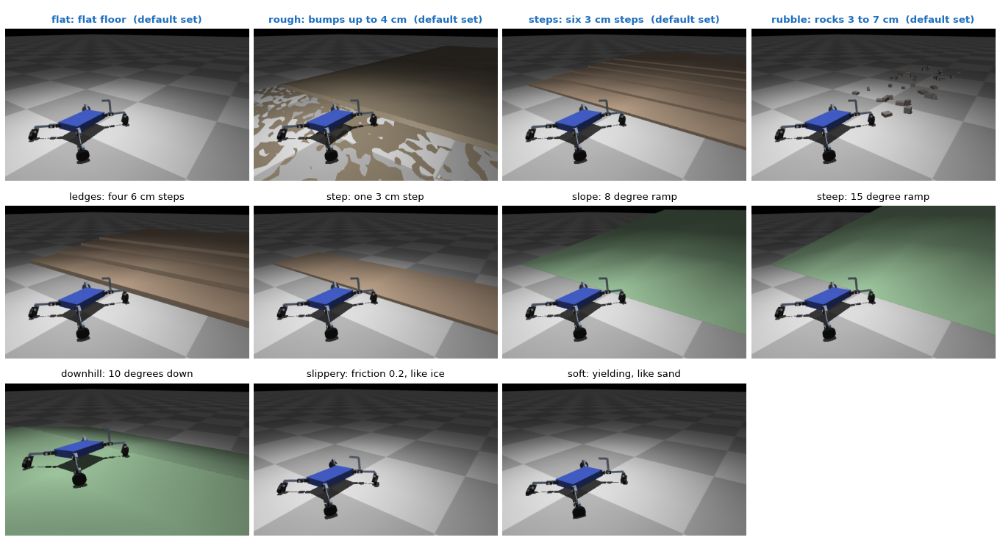

# Environments and presets



Unless a run says otherwise, the robots shown in this documentation were
trained on the default set: flat floor, bumps, low steps and rubble (`terrain`).

Every robot is scored on each environment of the run, and its fitness mixes the
average with the worst one (`0.7 * mean + 0.3 * min`), so the search favours
robots that cope with all of them. Pick the environments with `--terrains`:

```bash
python experiments/train.py --terrains rubble            # one environment only
python experiments/train.py --terrains flat,soft,steep   # your own list
python experiments/train.py --terrains terrain           # a ready set (below)
```

Fewer environments make a specialist (the best robot for sand, or for a
staircase); more make a generalist. The choice is saved in the archive, so
`replay`, `validate` and `export` use the same ones.

| Name | What the robot faces |
|------|----------------------|
| `flat` | flat floor |
| `rough` | smoothed random bumps up to 4 cm, flat near the spawn |
| `rubble` | 40 scattered rocks 3 to 7 cm high, taller than many wheels can climb |
| `steps` | six low steps, 3 cm high and 50 cm deep, the first at x = 0.6 m (see below) |
| `ledges` | staircase of four 6 cm steps, too tall to roll up |
| `step` | one 3 cm step, 0.50 m ahead of the spawn, 1 m deep |
| `slope` | 8 degree ramp up from x = 0.5 m |
| `steep` | the same ramp at 15 degrees |
| `downhill` | spawn on a plateau, then a 10 degree slope down to the floor |
| `slippery` | floor with friction 0.2, like ice |
| `soft` | yielding floor like sand: feet sink 1 to 2 cm and wheels feel rolling drag |

**How hard `steps` is.** It is not a house staircase: each step is 3 cm high
(a house step is 17 to 18 cm, taller than most of these robots) and 50 cm deep.
A good robot covers 1.5 to 2.3 m in its first 5 s, so it meets the first two to
four steps, at x = 0.6, 1.1, 1.6 and 2.1 m. A wheel climbs an edge up to about
its own radius, and wheels here are 30 to 100 mm, so a low robot on wheels rolls
up a 3 cm step; a low body without wheels can push its torso over the edge like
a sled. Robots trained only on flat ground still mostly stall there. `ledges`
doubles the height to 6 cm, too tall for small wheels to roll up.

Ready sets:

| Set | Environments |
|-----|--------------|
| `flat` | flat |
| `terrain` | flat, rough, steps, rubble |
| `all` | all of the above except `step` |

### Changing an environment's measures

Every environment is a function with keyword arguments, and the command line
can set them: a colon after the name, then `key=value` pairs separated by
colons, with commas between environments.

```bash
python experiments/train.py --terrains "steps:rise=0.08:run=0.3,slope:degrees=12"
python experiments/replay.py --terrain "steps:rise=0.06"
```

The arguments are the ones in `darwinbot/terrain.py` (for `steps`: `rise` and
`run` in metres, `count`; for `slope`: `degrees`, `start`, `length`). An
unknown argument, a value that is not a number or a fraction for a count is
refused with the list of valid arguments. The archive keeps the whole string,
so `replay`, `validate` and `export` rebuild the same ground, and the scores
are labelled with it (`steps:rise=0.08:run=0.3`).

`rough` and `rubble` are random. Training draws new bumps and rocks for every
body, so a family of robots cannot memorise one layout; `replay` and `validate`
use one fixed layout, so a robot always meets the same ground there.

## Make your own environment

An environment is a function that returns a `Terrain`: a name, the MuJoCo XML
of the world (boxes, cylinders, meshes, anything MuJoCo loads), the ground
friction and the ground height at the spawn. Write it in a file of your own,
register it with `terrain.register_terrain`, and pass the file with `--plugin`
([Plugins](plugins.md)):

```bash
python experiments/train.py --plugin tunnel.py --terrains tunnel          # only the new one
python experiments/train.py --plugin tunnel.py --terrains flat,tunnel     # mixed with others
```

### Worked example: a staircase that grows to a house step

`examples/plugins/progressive_stairs.py` adds `progressive-stairs`: four steps
on 28 cm treads whose risers grow from 4 to 8, 12 and 17 cm, the height of a
house step, with the first riser at x = 0.6 m. The low first step lets
evolution get a foothold; each next one filters out the bodies that cannot
lift that high, so the score says how far up a robot gets.

Start from your own walker (see [Starting from your own design](own-design.md)),
then let evolution take over. Episodes of 10 s give a slow climber the time to
reach the top step, and the `forward` task scores distance only, with no turning
episodes:

```bash
python experiments/seed.py --robot examples/robots/small-walker.yaml \
    --plugin examples/plugins/progressive_stairs.py \
    --terrains flat,progressive-stairs --task forward --seconds 10 --out checkpoints/stairs
python experiments/train.py --resume checkpoints/stairs/archive.pkl --batches 30 \
    --plugin examples/plugins/progressive_stairs.py
python experiments/replay.py --archive checkpoints/stairs/archive.pkl --list \
    --plugin examples/plugins/progressive_stairs.py
```

With `flat` in the set a body still earns for walking on level ground before
it can climb, which keeps the early batches from scoring only stalls. Most
evolved robots carry their torso lower than the top risers, so the 17 cm step
is a real limit, not a formality.

Evolution then keeps the bodies and gaits that do best there. A few things
decide whether the result is what you expect:

- **Episodes are short.** Each test lasts 8 s and good robots cover about
  1.5 m in the first 5, so the challenge has to sit within the first metre or two after the
  spawn (x = 0, robots head towards +x).
- **The score stays the same.** It rewards distance along x, turning when told
  to, low energy and not falling. A tunnel rewards going through it forwards;
  reaching a goal or solving a maze would need a new task in `fitness.py`, and
  the robots have no sensors to find their way.
- **A fixed layout gets memorised.** With every object always in the same
  place, evolution learns that one layout. Draw the layout from a seed, as
  `rough` and `rubble` do, so every body meets a new one.
- **The map is still measured on flat ground.** The archive's axes (contact
  time, height, servos, legs, cost of transport) come from the flat floor; a new
  environment changes the fitness, not how robots are sorted.
- **Contacts cost time.** `rubble` has 40 rocks; hundreds of objects can make
  training several times slower.
- **The world can touch the robot at the spawn.** The spawn check only looks
  for parts of the robot touching each other, so a ceiling lower than a body
  pins it in place, which in practice filters tall bodies out.

## Tasks and presets

The ready-made tasks and the `--preset` option are described in [Fitness and tasks](fitness-tasks.md).
