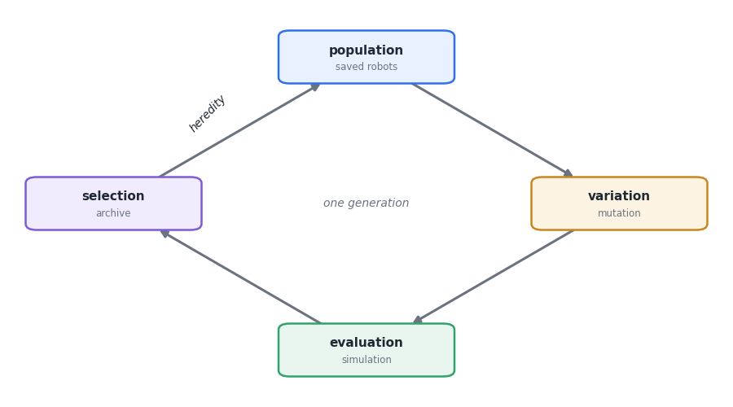
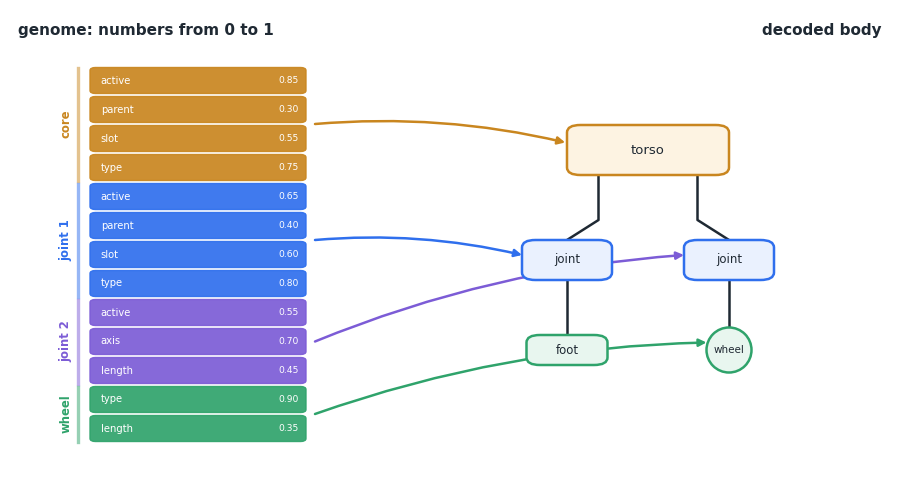
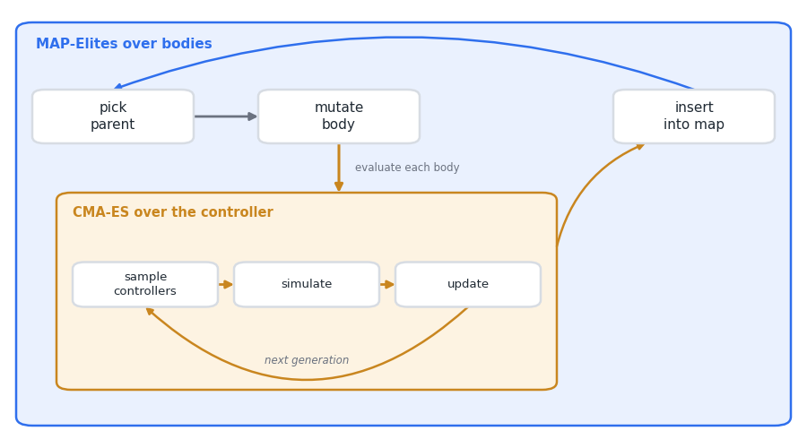
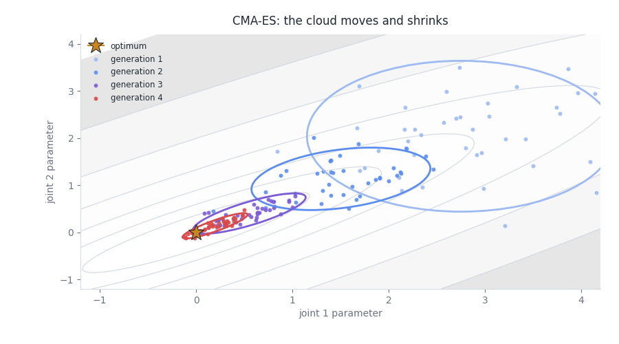
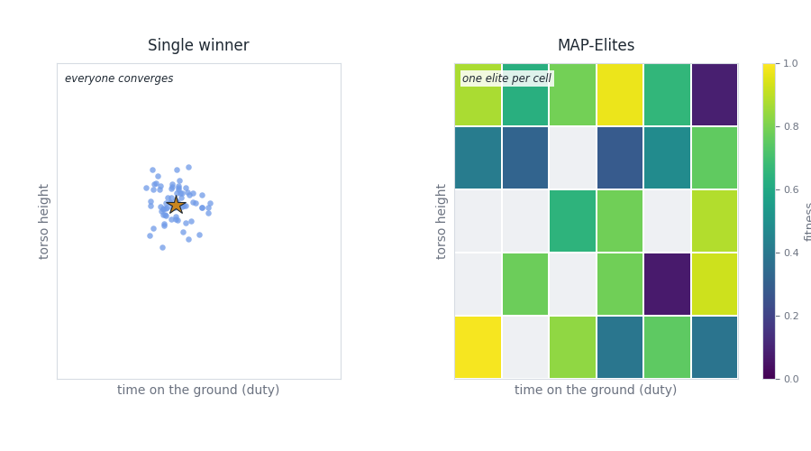
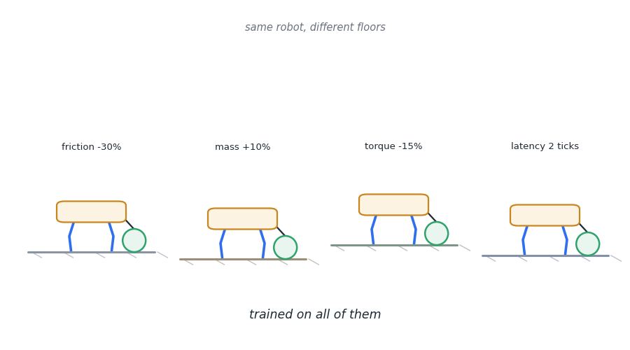

# Guide: artificial evolution with DarwinBot

*Versão em português: [guia-evolucao.md](guia-evolucao.md)*

This guide is for anyone who has never touched evolutionary algorithms and
wants to understand how DarwinBot invents robots. Each section explains one
idea in a few words and points to where it lives in the code, so you can
read it, run it and change it.

You don't need any math beyond high school. You need curiosity and an
ordinary computer: everything here runs on a laptop.

## 1. The idea in one minute

Natural evolution needs three ingredients:

- **variation**: children are not perfect copies of their parents;
- **selection**: not everyone survives, and the ones that work better leave more descendants;
- **inheritance**: what worked is passed on to the next generation.

Repeat that many times and solutions appear that nobody designed. An
evolutionary algorithm does exactly this inside the computer: it creates
candidates, measures how good they are, keeps the best ones and generates
variations of them.



The technique is used outside robotics too: NASA evolved the shape of an
antenna that flew on the ST5 satellite (2006), and there are uses in part
design, task scheduling and tuning neural networks. It shines when the
problem is hard to solve with formulas but easy to evaluate ("how many
meters did this robot walk?").

## 2. Genotype and phenotype

In biology, the **genotype** is the DNA and the **phenotype** is the
organism it produces. In DarwinBot:

- the genotype is a vector of numbers between 0 and 1;
- the phenotype is the robot's body: a tree of modules (trunk, servo
  joints, links, TPU springs, wheels, feet, tails, skids, spikes and free
  caster wheels).



The vector is split into blocks, one per module "slot". Each block says
whether the slot is active, who the parent is, which socket it attaches to,
what type of module it is, the joint axis, the link length and so on.

The measures are continuous: link length goes from 40 to 200 mm, the
section from 12 to 30 mm by 3 to 10 mm, the elbow has its own distance and
angle, the mount rolls to any angle and can sit anywhere along the torso
edge. Each block has 13 genes. The passive modules (spring, tail with
counterweight, skid, spike, caster) have no servo.

**In the code:** `darwinbot/morphology.py`, functions `decode` (genome to
body) and `encode` (body to genome).

One important detail: `decode` accepts **any** vector and always returns a
valid body. Slots that contradict each other are discarded. This looks
small, but it is what lets mutation tinker freely without producing
impossible "monsters".

## 3. Mutation

Variation comes from **mutation**: take a robot that works and change it a
little. DarwinBot uses seven operators, drawn with different weights:

| Operator | What it does | Chance |
|---|---|---|
| `param` | changes a continuous measure (length, section, elbow, roll, radius); one change in five is a large jump | 30% |
| `add` | adds a module in a free socket | 20% |
| `type` | swaps a module's type (a joint becomes a link, spring, tail, skid, spike or caster, for example) | 15% |
| `mirror` | copies a limb to the opposite side, mirrored | 15% |
| `remove` | removes a whole limb | 10% |
| `copy` | copies a limb to another socket | 5% |
| `scale` | stretches or shrinks a whole limb, from half to double | 5% |

The `mirror` operator deserves attention: symmetry helps walking, and
duplicating a limb that already works is a shortcut that natural evolution
also uses (think of an insect's pairs of legs).

**In the code:** `MUTATIONS` and the `_op_*` functions in `morphology.py`.

Many genetic algorithms also use **crossover** (mixing the genome of two
parents). Cutting two bodies in half and swapping the halves almost always
breaks both, so DarwinBot uses a gentler form, the **graft**: a whole limb of
another robot on the map is attached to a free slot of the parent, sometimes
mirrored on the other side. One child in five is born this way. Karl Sims used
the same idea for his creatures in 1994.

## 4. The score (fitness)

Selection needs a criterion. A robot's score, after a few seconds of
simulation, is:

```
score = forward progress - 0.5 × lateral drift - 0.05 × energy spent - 0.5 × (fell?)
```

Walking forward earns points; walking crooked, spending too much energy and
falling lose points. With several terrains, the final score mixes the
average with the worst terrain, to reward robust robots.

**In the code:** `darwinbot/fitness.py`.

**Be careful what you ask for.** Evolution optimizes the score, not your
intention. If the score has a loophole, it will be found: there are famous
cases of simulated robots that learned to "walk" by exploiting physics
bugs, or to earn points by falling in a specific way. DarwinBot already
guards against some of them: a body with overlapping parts isn't even
simulated, and physics that "explodes" gets a score of -5. A good exercise
is to change the score and see what cheating shows up.

## 5. Two loops: body and brain

A new body doesn't know how to walk. If we judged the body with a random
movement, we would discard good bodies just because the drawn movement was
bad. That is why DarwinBot has two loops, one inside the other:



- **Outer loop (bodies):** picks parents, creates mutant bodies and keeps
  the best ones. That is MAP-Elites, in section 6.
- **Inner loop (control):** for each new body, **CMA-ES** searches for the
  joint movement rhythm that takes that body furthest.

The control is a **CPG** (central pattern generator): each joint follows a
wave, with its own amplitude, phase and offset, like the spinal circuits
that generate the walking rhythm in animals. A feedback from the servo load
(Tegotae) lets each leg delay or advance its step according to the weight it
carries.

### CMA-ES without heavy math

CMA-ES is an **evolution strategy**, a cousin of genetic algorithms. It
draws a cloud of candidates around a point, measures them all, moves the
center toward the best ones and adjusts the shape of the cloud: it stretches
in the direction that is working and shrinks when it gets close to the
optimum.



**In the code:** `darwinbot/inner.py` (uses the `pycma` library) and
`darwinbot/controller.py` (the CPG).

## 6. Quality diversity: the best of each kind

A classic genetic algorithm looks for **one** winner. The problem is that the
population tends to converge: everyone becomes a copy of the first robot
that worked reasonably well, and different ideas die before they mature.

**MAP-Elites** (Mouret and Clune, 2015) does it differently. It divides the
behavior space into a map and keeps **the best robot of each region**. In
DarwinBot, the axes of the map are:

- `duty`: how long the feet stay on the ground (crawling, walking, trotting);
- `height`: trunk height;
- `legs`: number of legs (limbs with a joint and no wheel);
- `cot`: cost of transport (energy per weight and distance).



A new robot only competes with the current owner of **its** region. So a
slow crawler stays on the map next to a fast roller, and the result is a
catalog of different solutions.

There is a less obvious gain: the regions serve as **stepping stones**. A
champion robot often descends from ancestors that lived in very different
regions. A search for a single winner would have thrown those ancestors
away.

**In the code:** `darwinbot/evolve.py` (`Archive` class, uses the `pyribs`
library). To see the stepping stones: `python experiments/lineage.py`.

## 7. Novelty and inheritance

**Who becomes a parent.** Instead of drawing parents at random, DarwinBot
gives more chance to robots that are **isolated** on the map, far from their
neighbors (`--parent-selection novelty`). This pushes the search toward
little-explored regions. It is a version of the "novelty search" of Lehman
and Stanley.

**What the child inherits.** The child inherits the mutated body and also
the control the parent learned, and starts CMA-ES from there. This is
**Lamarckian inheritance** (inheriting what the parent learned in life):
wrong in biology, but great in the computer, because the child doesn't
relearn how to walk from scratch.

## 8. From simulator to the real world

Robots evolved in simulation usually fail in the real world (the "reality
gap"): evolution explores details of the simulated physics that don't really
exist. DarwinBot uses three defenses:

1. **Real parts:** only STS3215 servos, printed parts and electronics you
   can buy, with mass and torque from the catalog.
2. **Varied physics** (domain randomization): each robot is trained in
   versions with slightly different friction, mass, torque, backlash and
   delay. A movement that only works under one exact physics doesn't
   survive.
3. **Validation:** `experiments/validate.py` tests the robot under 50
   varied physics and approves it if it loses less than 30% of its
   performance.

There is a fourth defense, **natural selection by the printer**: a body is
buildable only if every part fits a 220 mm print bed, every link survives
the servo stall torque (1.91 N*m) with a bending stress of at most 25 MPa
(half of what PLA takes), and no parts overlap. The torso has no limit: it
is split into bed-sized tiles joined by splice plates. A body that breaks a
rule is scored as unbuildable and is never simulated.



**In the code:** `darwinbot/randomize.py`.

## 9. Try it

The commands run from the project root, with the environment installed (see
the README). Small trainings take minutes.

1. **A minimal training** to see the cycle:
   ```
   python experiments/train.py --terrains flat --init 6 --batches 3 --batch-size 4 --budget-init 20 --budget-child 10 --workers 1 --variants 0 --seed 1 --out /tmp/exp1
   python experiments/replay.py --archive /tmp/exp1/archive.pkl --list
   ```
   Watch the `cells` column of the `train.py` log grow with each batch: those
   are the new kinds found (`replay.py --list` prints the types themselves).
2. **Novelty versus random draw:** repeat with `--parent-selection uniform`
   and the same `--seed`. How many kinds did each one find?
3. **Change the score:** in `darwinbot/fitness.py`, set `ENERGY_W` to zero
   (free energy). Do the robots get faster? More clumsy?
4. **See a robot:** `python experiments/replay.py --archive /tmp/exp1/archive.pkl --type <type>`
   opens the 3D viewer.
5. **Follow a lineage:** train more batches and run
   `python experiments/lineage.py --archive /tmp/exp1/archive.pkl --type <type>`.

## 10. Glossary

| Term | Meaning |
|---|---|
| Genotype / genome | the numbers that describe a robot |
| Phenotype | the robot built from the genome |
| Fitness / score | how well the robot performs the task |
| Mutation | a random change in a child's genome |
| Crossover | mixing the genome of two parents (here, grafting a whole limb) |
| Elite | the best robot kept in a region of the map |
| Descriptor | a behavior measurement that defines a robot's region |
| CPG | central pattern generator, the rhythmic control of the joints |
| CMA-ES | evolution strategy that tunes the control |
| MAP-Elites | algorithm that keeps the best of each region |
| Reality gap | the difference between simulation and the real world |

## 11. Further reading

- K. Sims, "Evolving Virtual Creatures", SIGGRAPH 1994. The classic: creatures
  with evolved body and brain, the origin of the tree body.
- J.-B. Mouret and J. Clune, "Illuminating search spaces by mapping elites",
  2015. MAP-Elites.
- J. Lehman and K. O. Stanley, "Abandoning Objectives: Evolution Through the
  Search for Novelty Alone", 2011. Novelty search.
- N. Hansen, "The CMA Evolution Strategy: A Tutorial", 2016.
- J. Lehman et al., "The Surprising Creativity of Digital Evolution", 2018.
  A collection of "cheats" found by evolution, a great read.
- A. E. Eiben and J. E. Smith, *Introduction to Evolutionary Computing*,
  Springer. The textbook of the field.
