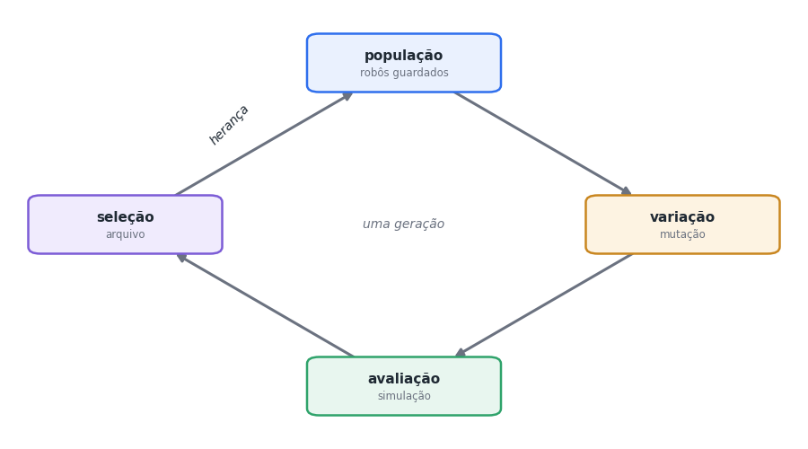
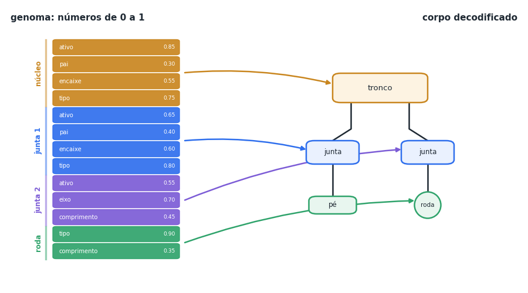
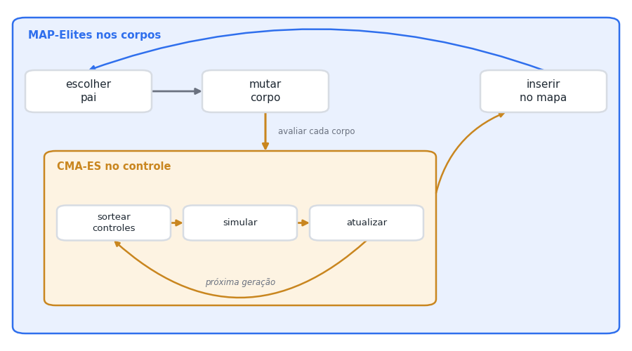
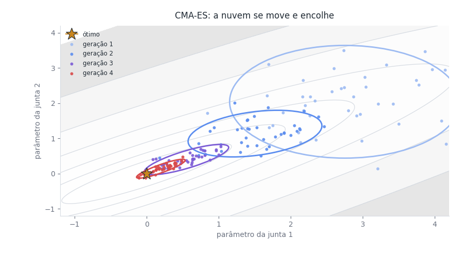
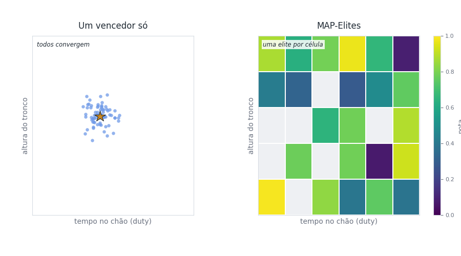
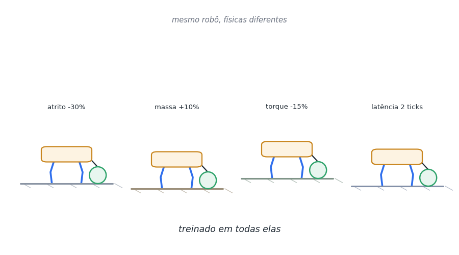

# Guia: evolução artificial com o DarwinBot

*English version: [evolution-guide.md](evolution-guide.md)*

Este guia é para quem nunca mexeu com algoritmos evolutivos e quer entender
como o DarwinBot inventa robôs. Cada seção explica uma ideia em poucas
palavras e aponta onde ela está no código, para você ler, rodar e mudar.

Não precisa de matemática além do ensino médio. Precisa de curiosidade e de
um computador comum: tudo aqui roda num notebook.

## 1. A ideia em um minuto

A evolução natural precisa de três ingredientes:

- **variação**: os filhos não são cópias perfeitas dos pais;
- **seleção**: nem todos sobrevivem, e os que funcionam melhor deixam mais descendentes;
- **herança**: o que funcionou passa para a geração seguinte.

Repita isso muitas vezes e surgem soluções que ninguém projetou. Um
algoritmo evolutivo faz exatamente isso dentro do computador: cria
candidatos, mede quão bons eles são, guarda os melhores e gera variações
deles.



A técnica é usada fora da robótica também: a NASA evoluiu a forma de uma
antena que voou no satélite ST5 (2006), e há usos em projeto de peças,
escalonamento de tarefas e ajuste de redes neurais. Ela brilha quando o
problema é difícil de resolver com fórmulas, mas fácil de avaliar ("este
robô andou quantos metros?").

## 2. Genótipo e fenótipo

Na biologia, o **genótipo** é o DNA e o **fenótipo** é o organismo que ele
produz. No DarwinBot:

- o genótipo é um vetor de números entre 0 e 1;
- o fenótipo é o corpo do robô: uma árvore de módulos (tronco, segmentos de
  coluna, juntas com servo, links, molas de TPU, rodas, pés, caudas, patins,
  espetos e rodas livres).



O vetor é dividido em blocos, um por "vaga" de módulo. Cada bloco diz se a
vaga está ativa, quem é o pai, em que encaixe ela se prende, que tipo de
módulo é, o eixo da junta, o comprimento do link e assim por diante.

As medidas são contínuas: o comprimento do link vai de 40 a 200 mm, a seção
de 12 a 30 mm por 3 a 10 mm, o cotovelo tem distância e ângulo próprios, o
encaixe gira em qualquer ângulo e pode ficar em qualquer ponto da borda, do
topo ou da base do tronco. O contorno do tronco é um polígono de 8 vértices
que a evolução deforma, o link pode ser reto, em L ou em arco, o pé pode ser
esfera, lâmina, pata ou garra, e o tronco pode ganhar até duas placas extras
ligadas por servos de coluna. Cada bloco tem 15 genes. Os módulos passivos (mola, cauda com
contrapeso, patim, espeto, roda livre) não têm servo.

**No código:** `darwinbot/morphology.py`, funções `decode` (genoma para
corpo) e `encode` (corpo para genoma).

Um detalhe importante: `decode` aceita **qualquer** vetor e sempre devolve
um corpo válido. Vagas que se contradizem são descartadas. Isso parece
pequeno, mas é o que permite à mutação mexer à vontade sem gerar
"monstros" impossíveis.

## 3. Mutação

A variação vem da **mutação**: pegar um robô que funciona e mudar um pouco.
O DarwinBot usa sete operadores, sorteados com pesos diferentes:

| Operador | O que faz | Chance |
|---|---|---|
| `param` | ajusta uma medida contínua (comprimento, seção, cotovelo, rotação, raio, contorno do tronco, dobra do link, forma do pé); um ajuste em cada cinco é um salto grande | 30% |
| `add` | acrescenta um módulo num encaixe livre | 20% |
| `type` | troca o tipo de um módulo (junta vira link, mola, cauda, patim, espeto ou roda livre, por exemplo) | 15% |
| `mirror` | copia um membro para o lado oposto, espelhado | 15% |
| `remove` | tira um membro inteiro | 10% |
| `copy` | copia um membro para outro encaixe | 5% |
| `scale` | estica ou encolhe um membro inteiro, de metade ao dobro | 5% |

O `mirror` merece atenção: simetria ajuda a andar, e duplicar um membro que
já funciona é um atalho que a evolução natural também usa (pense nos pares
de patas de um inseto).

**No código:** `MUTATIONS` e as funções `_op_*` em `morphology.py`.

Muitos algoritmos genéticos também usam **cruzamento** (misturar o genoma de
dois pais). Cortar dois corpos ao meio e trocar as metades quase sempre quebra
os dois, então o DarwinBot usa uma forma mais suave, o **enxerto**: um membro
inteiro de outro robô do mapa é encaixado numa vaga livre do pai, às vezes
espelhado do outro lado. Um em cada cinco filhos nasce assim. Karl Sims usou a
mesma ideia nas criaturas dele, em 1994.

## 4. A nota (fitness)

Seleção precisa de um critério. A nota de um robô, depois de alguns segundos
de simulação, é:

```
nota = avanço - 0,5 × desvio lateral - 0,05 × energia gasta - 0,5 × (caiu?)
```

Andar para a frente conta pontos; andar torto, gastar energia demais e cair
tiram pontos. Com vários terrenos, a nota final mistura a média com o pior
terreno, para premiar robôs robustos.

**No código:** `darwinbot/fitness.py`.

**Cuidado com o que você pede.** A evolução otimiza a nota, não a sua
intenção. Se a nota tiver uma brecha, ela será achada: há casos famosos de
robôs simulados que aprenderam a "andar" explorando erros da física, ou a
ganhar pontos caindo de um jeito específico. O DarwinBot já se protege de
alguns: um corpo com peças sobrepostas nem é simulado, e física que "explode"
recebe nota -5. Um bom exercício é mudar a nota e ver que trapaça aparece.

## 5. Dois laços: corpo e cérebro

Um corpo novo não sabe andar. Se julgássemos o corpo com um movimento
aleatório, descartaríamos bons corpos só porque o movimento sorteado era
ruim. Por isso o DarwinBot tem dois laços, um dentro do outro:



- **Laço de fora (corpos):** escolhe pais, cria corpos mutantes e guarda os
  melhores. É o MAP-Elites, na seção 6.
- **Laço de dentro (controle):** para cada corpo novo, o **CMA-ES** procura o
  ritmo de movimento das juntas que leva esse corpo mais longe.

O controle é um **CPG** (gerador central de padrões): cada junta segue uma
onda, com amplitude, fase e deslocamento próprios, como os circuitos da
medula que geram o ritmo da caminhada nos animais. Um retorno da carga do
servo (Tegotae) deixa cada perna atrasar ou adiantar seu passo conforme o
peso que sustenta.

### CMA-ES sem matemática pesada

O CMA-ES é uma **estratégia de evolução**, prima dos algoritmos genéticos.
Ele sorteia uma nuvem de candidatos em volta de um ponto, mede todos, move
o centro na direção dos melhores e ajusta o formato da nuvem: estica na
direção que está dando certo e encolhe quando chega perto do ótimo.



**No código:** `darwinbot/inner.py` (usa a biblioteca `pycma`) e
`darwinbot/controller.py` (o CPG).

## 6. Quality diversity: o melhor de cada tipo

Um algoritmo genético clássico procura **um** vencedor. O problema é que a
população tende a convergir: todos viram cópias do primeiro robô que
funcionou razoavelmente, e ideias diferentes morrem antes de amadurecer.

O **MAP-Elites** (Mouret e Clune, 2015) faz diferente. Ele divide o espaço de
comportamentos num mapa e guarda **o melhor robô de cada região**. No
DarwinBot, os eixos do mapa são:

- `duty`: quanto tempo as pontas ficam no chão (rastejar, andar, trotar);
- `height`: altura do tronco;
- `legs`: número de pernas (membros com junta e sem roda);
- `cot`: custo de transporte (energia por peso e distância).



Um robô novo só disputa com o atual dono da **sua** região. Assim, um
rastejador lento continua no mapa ao lado de um rolador rápido, e o
resultado é um catálogo de soluções diferentes.

Há um ganho menos óbvio: as regiões servem de **degraus**. Um robô campeão
muitas vezes descende de ancestrais que viveram em regiões bem diferentes.
Uma busca por um único vencedor teria jogado esses ancestrais fora.

**No código:** `darwinbot/evolve.py` (classe `Archive`, usa a biblioteca
`pyribs`). Para ver os degraus: `python experiments/lineage.py`.

## 7. Novidade e herança

**Quem vira pai.** Em vez de sortear pais ao acaso, o DarwinBot dá mais
chance aos robôs **isolados** no mapa, longe dos vizinhos
(`--parent-selection novelty`). Isso empurra a busca para regiões pouco
exploradas. É uma versão da "busca por novidade" de Lehman e Stanley.

**O que o filho herda.** O filho herda o corpo mutado e também o controle
que o pai aprendeu, e começa o CMA-ES dali. Isso é **herança lamarckiana**
(herdar o que o pai aprendeu em vida): errada na biologia, mas ótima no
computador, porque o filho não reaprende a andar do zero.

## 8. Do simulador ao mundo real

Robôs evoluídos em simulação costumam falhar no mundo real (o "reality
gap"): a evolução explora detalhes da física simulada que não existem de
verdade. O DarwinBot usa três defesas:

1. **Peças reais:** só servos STS3215, peças impressas e eletrônica que se
   compra, com massa e torque do catálogo.
2. **Física variada** (domain randomization): cada robô é treinado em
   versões com atrito, massa, torque, folga e atraso um pouco diferentes.
   Um movimento que só funciona numa física exata não sobrevive.
3. **Validação:** `experiments/validate.py` testa o robô em 50 físicas
   variadas e aprova se ele perde menos de 30% do desempenho.

Há ainda uma quarta defesa, a **seleção natural pela impressora**: um corpo
só é construível se cada peça couber numa mesa de 220 mm, se cada link
aguentar o torque de travamento do servo (1,91 N*m) com tensão de flexão de
no máximo 25 MPa (metade do que o PLA suporta) e se nenhuma peça se
sobrepuser. O tronco não tem limite: é cortado em placas do tamanho da mesa,
unidas por placas de emenda, e cada segmento de coluna é uma placa própria. Corpo que quebra uma regra é pontuado como não
construível e nunca é simulado.



**No código:** `darwinbot/randomize.py`.

## 9. Experimente

Os comandos rodam da raiz do projeto, com o ambiente instalado (veja o
README). Treinos pequenos levam minutos.

1. **Um treino mínimo** para ver o ciclo:
   ```
   python experiments/train.py --terrains flat --init 6 --batches 3 --batch-size 4 --budget-init 20 --budget-child 10 --workers 1 --variants 0 --seed 1 --out /tmp/exp1
   python experiments/replay.py --archive /tmp/exp1/archive.pkl --list
   ```
   Observe a coluna `cells` do log do `train.py` crescer a cada lote: são os
   tipos novos achados (o `replay.py --list` mostra os tipos em si).
2. **Novidade contra sorteio:** repita com `--parent-selection uniform`
   e o mesmo `--seed`. Quantos tipos cada um achou?
3. **Mude a nota:** em `darwinbot/fitness.py`, zere `ENERGY_W` (energia
   de graça). Os robôs ficam mais rápidos? Mais desajeitados?
4. **Veja um robô:** `python experiments/replay.py --archive /tmp/exp1/archive.pkl --type <tipo>`
   abre o visualizador 3D.
5. **Siga uma linhagem:** treine mais lotes e rode
   `python experiments/lineage.py --archive /tmp/exp1/archive.pkl --type <tipo>`.

## 10. Glossário

| Termo | Significado |
|---|---|
| Genótipo / genoma | os números que descrevem um robô |
| Fenótipo | o robô construído a partir do genoma |
| Fitness / nota | quão bem o robô cumpre a tarefa |
| Mutação | mudança aleatória no genoma de um filho |
| Cruzamento | mistura do genoma de dois pais (aqui, enxerto de um membro inteiro) |
| Elite | o melhor robô guardado numa região do mapa |
| Descritor | uma medida de comportamento que define a região de um robô |
| CPG | gerador central de padrões, o controle rítmico das juntas |
| CMA-ES | estratégia de evolução que ajusta o controle |
| MAP-Elites | algoritmo que guarda o melhor de cada região |
| Reality gap | diferença entre simulação e mundo real |

## 11. Para ler depois

- K. Sims, "Evolving Virtual Creatures", SIGGRAPH 1994. O clássico: criaturas
  com corpo e cérebro evoluídos, origem do corpo em árvore.
- J.-B. Mouret e J. Clune, "Illuminating search spaces by mapping elites",
  2015. O MAP-Elites.
- J. Lehman e K. O. Stanley, "Abandoning Objectives: Evolution Through the
  Search for Novelty Alone", 2011. Busca por novidade.
- N. Hansen, "The CMA Evolution Strategy: A Tutorial", 2016.
- J. Lehman et al., "The Surprising Creativity of Digital Evolution", 2018.
  Coletânea de "trapaças" encontradas pela evolução, ótima leitura.
- A. E. Eiben e J. E. Smith, *Introduction to Evolutionary Computing*,
  Springer. O livro-texto da área.
