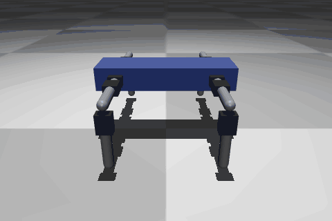
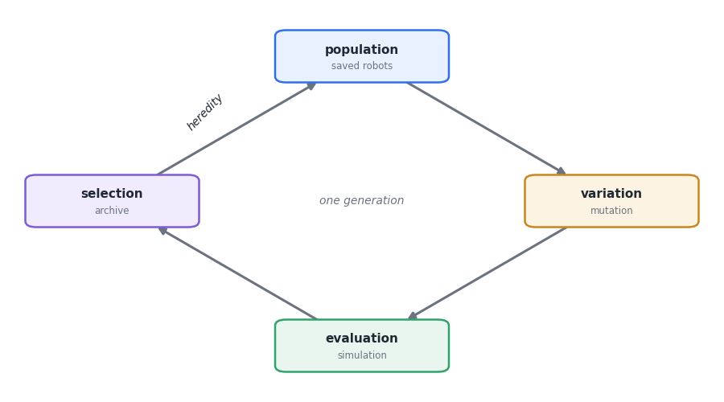

# DarwinBot

Quality-diversity evolution of robot bodies and locomotion controllers, built
from real parts so the result can be printed and assembled.

Every robot is a tree of real modules (Karl Sims and Revolve2 style): a core
(a torso plate with a free contour, ESP32, LiPo) with servo joints, spine
segments, passive links (straight, L or arc), TPU springs, tails, skids, spikes,
caster wheels, wheels and feet (sphere, blade, pad or claw) hanging from its
slots, driven by Feetech STS3215 servos. Only the interfaces are fixed (servo,
horn and bracket holes, M3 screws, electronics); torso contour, link length,
section, profile and bend, elbow, roll, mount position and foot size are
continuous genes, and a body that the printer or the
servo torque could not deal with is not buildable. Bodies are evolved
with a MAP-Elites archive laid out by behaviour and cost, while a central
pattern generator with two harmonics per joint and load feedback (Tegotae) is
tuned with CMA-ES for each candidate body. Any robot in the archive can be
exported as printable parts, a bill of materials and a control file for an ESP32.

## What makes it different

The program invents robots and teaches each one to move. A robot is a tree of
modules; evolution decides how many limbs, how long (continuous lengths, in
millimetres, straight or bent), which way each joint turns, what outline the
torso has, whether it is split in segments, where each part mounts on the torso
(edge, top or bottom face) and whether a limb ends in a wheel or a shaped foot.
Passive modules without a servo (TPU spring,
tail with counterweight, skid, spike, caster wheel) are part of the search. A
body the printer or the servo could not handle is not buildable and is never
simulated. For every new body, an optimiser searches for
the rhythm of joint movements that carries it farthest forward in a few simulated
seconds. The run does not keep a single winner: it keeps the best robot for each
*behaviour* (crawling low with few servos, trotting tall with many, rolling...),
so at the end you can browse a catalogue of different solutions.

## New to evolutionary algorithms?

Read the beginner guide: [English](evolution-guide.md) ·
[Português](guia-evolucao.md). It explains genomes, mutation, fitness,
CMA-ES, MAP-Elites, novelty search and the reality gap, each with pointers to
the code and small experiments to run on a laptop.

## Where to go next

- [Install](install.md) and [First run](first-run.md)
- [How it works](overview.md)
- [Results](results.md) and the [gallery](gallery.md)
- [Exporting a robot](exporting.md) to build it
- [Roadmap](roadmap.md)
