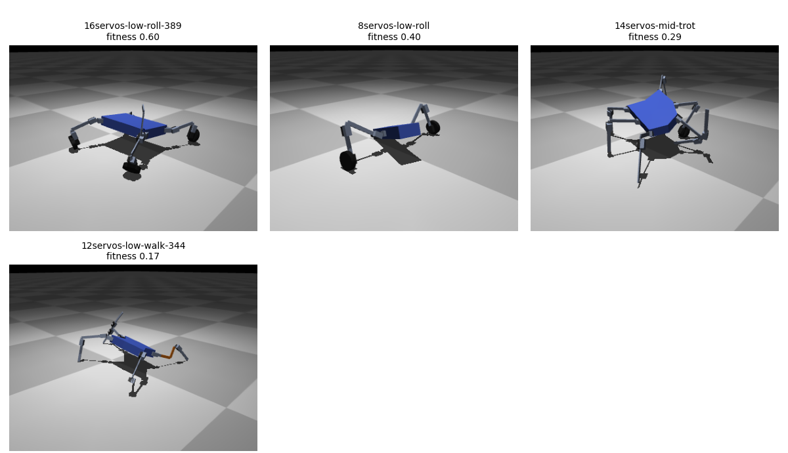
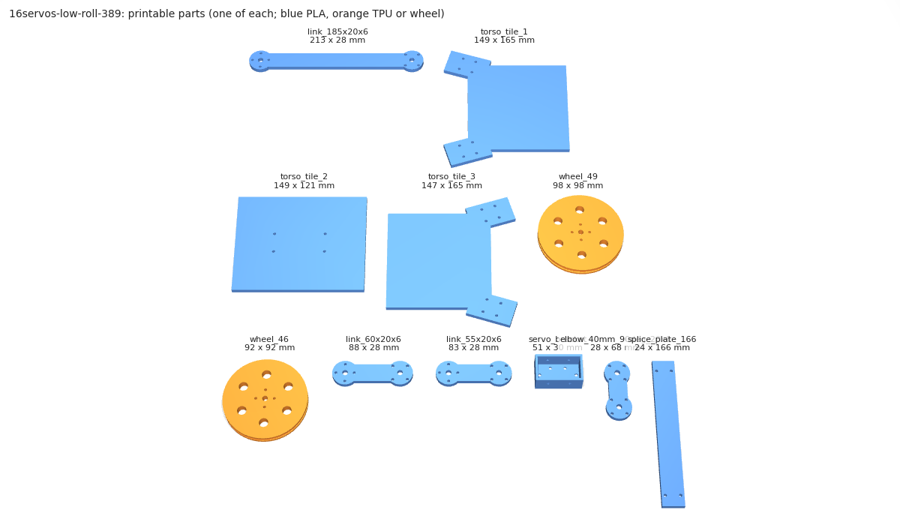
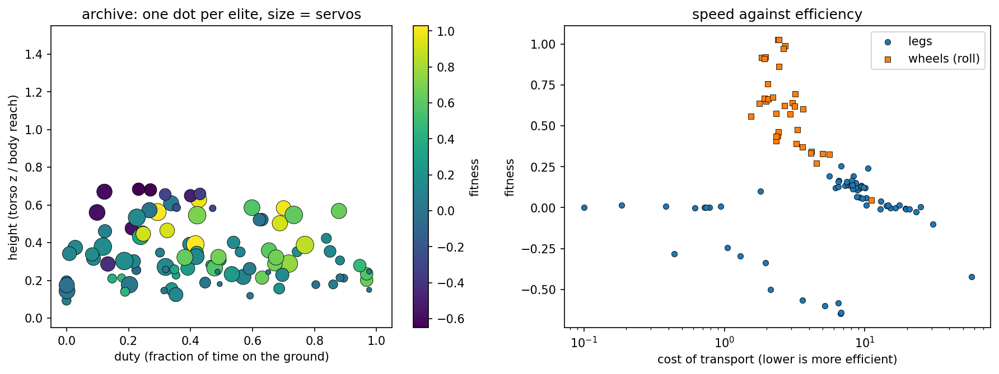
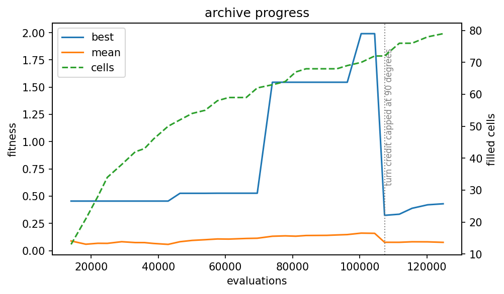

# Results

This page says what the project has achieved and how it was measured. The
numbers come from the run called long8, the showcase-2 release. Showcase-1
robots are not part of these tables, but they still play (see "Playing the
robots").

## How it is measured

- Every episode is 8 s of simulated time. A robot is judged on how far it
  progresses in the second half of the episode, and a fall before half-way
  scores no progress.
- The task is `steer`. Each evaluation runs four episodes: straight, left,
  right and half speed. The score is 0.4 for going straight, 0.4 for turning
  (the mean of left and right) and 0.2 for half speed.
- The archive is a CVT archive of 800 cells over five axes: duty, torso
  height, servo count, number of legs and cost of transport.
- A robot passes `experiments/validate.py` when its mean loss under varied
  physics is below 30%, its 5th percentile loss is below 60% and at most 10%
  of the variants fall. Every terrain must pass, not only the average.
  `--unseen` adds terrains the archive was not trained on.
- A robot passes `tools/check_assembly.py` when no printed part or servo
  body clashes with another and every horn hole lines up.
- Bodies that break a printing rule or overlap at spawn are not simulated.

## Showcase

long8 trained as islands on Kaggle and on two local machines for {{HOURS}}.
The hardware was {{HARDWARE}}. The task is `steer`, the episodes are 8 s and
the body model is 23.

The archive comes in four island settings. Their robots were scored on
different ground or with different parts, so the archives cannot be merged
with each other:

| Setting | Terrains | Wheels |
|---|---|---|
| Terrain preset | flat, rough, steps and rubble | allowed |
| Flat | flat only | allowed |
| Flat and steps | flat and steps | allowed |
| No wheels | terrain preset | not allowed |

Islands with the same setting merge with `experiments/merge_archives.py`,
which keeps the best elite of each cell. The four settings together fill
{{CELLS}} of the 800 cells and hold {{TYPES}} body types. {{LEGGED}} of them
have legs, and {{MOVERS}} move and also turn on command.




### Best robots

Each table lists the best robots of one setting after the longer controller
search (`experiments/polish.py`) and the removal of parts they do not need
(`experiments/prune.py`).

{{BEST_TABLE}}



### Validation

The robots above, run through `experiments/validate.py`:

{{VALIDATE_TABLE}}

### Turning

Turning is weaker than going straight. {{TURN_NOTE}}

The straight episode and the turn episodes share one controller, and a turn
is a command added to the same oscillators. A robot that walks well has
nothing in its gait that guarantees a good turn.

## Playing the robots

The archive of the showcase-2 robots is attached to the
[showcase-2 release](https://github.com/mpena2099/darwinbot/releases/tag/showcase-2),
with a snapshot of their gaits that any later version of the code can play.

```bash
curl -LO https://github.com/mpena2099/darwinbot/releases/download/showcase-2/showcase.snap.pkl
python experiments/replay.py --snapshot showcase.snap.pkl --list
python experiments/replay.py --snapshot showcase.snap.pkl --type <type> --speed 0.5
```

The showcase-1 robots (body model 20) still play from their own snapshot,
which needs no migration:

```bash
curl -LO https://github.com/mpena2099/darwinbot/releases/download/showcase-1/showcase.snap.pkl
python experiments/replay.py --snapshot showcase.snap.pkl --list
```

To export one of them, or to train on its archive, bring the archive up to
the current body model first. `experiments/migrate_archive.py` simulates
every robot again under the current rules, searches each controller again
and drops bodies that are no longer buildable
([resuming after a code change](long-runs.md#resuming-after-a-code-change)).

## Training it yourself

Run the `steer` preset (the `steer` task on the full terrain set; plain
`train.py` trains on flat ground only) as islands, then take the chosen
robots through
[the showcase steps](long-runs.md#from-an-archive-to-a-showcase):

```bash
python tools/kaggle/islands.py --user <you> --code-dataset <you>/darwinbot-code \
    --islands 5 --rounds 4 --batches-per-round 8 --train-args "--preset steer"
# or on one machine (much slower):
python experiments/train.py --preset steer --batches 200 --workers 8
```

`tools/kaggle/islands.py` takes the terrains and body options of each
island, which is how the four settings above were made. A different seed
gives different robots.

## What the archive looks like





The map shows the cells of one setting, coloured by fitness. The progress
plot follows the best fitness and the number of filled cells over the
batches of one island. {{PROGRESS_NOTE}}

## What counts as success

| Level | What it means | Reached? |
|-------|---------------|----------|
| **Minimum** | Diverse robots that walk or roll in simulation, built only from real parts | Yes |
| **Good** | An elite that passes `validate.py` (keeps most of its distance on randomised physics) and exports a coherent kit | Yes |
| **Moonshot** | A printed and assembled robot that walks with its evolved gait | No, it needs the hardware |

The value is in the pipeline being correct end to end, from genome to parts
list, not in any single robot.

## Known limitations

- {{WHEEL_NOTE}}
- The firmware is half done. `firmware/core/` runs the controller math,
  including the speed command and the servo speed, in portable C++, and a
  test proves it matches the Python controller tick by tick
  (`tests/test_firmware_parity.py`). The ESP32 layer (servo bus, load
  reading, calibration) waits for real hardware.
- Nothing has been built yet. Every number on this page comes from
  simulation, and the servo measures come from a STEP model, not from a
  caliper.
- The only feedback is the servo load. The controller turns when commanded
  but never sees the world, so tasks that need reacting (finding a doorway,
  avoiding a wall) are out of scope.
- A body whose parts overlap at spawn or sink more than 29 mm into the part
  they are mounted on, whose parts exceed the print bed or whose links bend
  beyond 25 MPa under the servo stall torque is not buildable and scores
  `UNSTABLE_SCORE` without being simulated (common among random trees).
- Spring stiffness comes from a TPU modulus that is not verified, and the
  printability stress check is a cantilever estimate, not a finite-element
  analysis.
- Archives of the four settings cannot be merged, so there is no single
  best robot, only the best of each setting.
